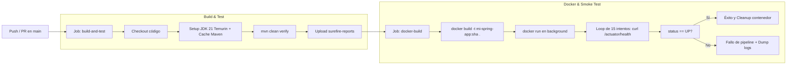

# Laboratorio Unidad 12: Externalización, Dockerización y Pipeline CI/CD


Proyecto de modernización DevOps para una aplicación Spring Boot (`plata-post1-u12`), que implementa la externalización de configuraciones mediante perfiles dinámicos, empaquetado seguro en contenedores Docker multi-stage y validación continua con GitHub Actions mediante pruebas de contexto y Smoke Tests automatizados.

---

## 📌 Tabla de Contenidos
1. [Descripción del Proyecto](#descripción-del-proyecto)
2. [Arquitectura y Estructura](#arquitectura-y-estructura)
3. [Decisiones de Diseño](#decisiones-de-diseño)
   - [1. Placeholders con Valores por Defecto](#1-placeholders-con-valores-por-defecto)
   - [2. Archivos Properties Separados](#2-archivos-properties-separados)
   - [3. Imagen JRE Alpine vs. Distroless](#3-imagen-jre-alpine-vs-distroless)
   - [4. Prueba Mínima de Carga de Contexto](#4-prueba-mínima-de-carga-de-contexto)
   - [5. Smoke Test sin Push a Registry](#5-smoke-test-sin-push-a-registry)
4. [Instrucciones de Ejecución Local](#instrucciones-de-ejecución-local)
   - [Compilación y Ejecución con Maven](#compilación-y-ejecución-con-maven)
   - [Construcción y Ejecución con Docker](#construcción-y-ejecución-con-docker)
5. [Guía de Despliegue en PaaS (Railway / Render)](#guía-de-despliegue-en-paas-railway--render)
6. [Flujo del Pipeline de CI/CD](#flujo-del-pipeline-de-cicd)

---

## 🚀 Descripción del Proyecto

El proyecto proporciona una API REST simple basada en Spring Boot 3.2.x y Java 21 para la gestión de productos, incorporando:
- **Spring Data JPA**: Persistencia desacoplada capaz de alternar entre H2 en memoria y PostgreSQL.
- **Spring Boot Actuator**: Exposición de métricas y health checks para diagnóstico del contenedor.
- **Multi-Stage Dockerfile**: Construcción reproducible que separa la fase de compilación del entorno de ejecución.
- **Pipeline de GitHub Actions**: Automatización de análisis, pruebas y smoke testing.

---

## 📂 Arquitectura y Estructura

```text
plata-post1-u12/
├── .github/
│   └── workflows/
│       └── ci.yml                     # Pipeline CI/CD con GitHub Actions
├── capturas/                          # Evidencias de ejecucion y pruebas
├── src/
│   ├── main/
│   │   ├── java/com/universidad/miapp/
│   │   │   ├── MiappApplication.java  # Clase principal Spring Boot
│   │   │   ├── controller/
│   │   │   │   └── ProductoController.java
│   │   │   ├── model/
│   │   │   │   └── Producto.java
│   │   │   └── repository/
│   │   │       └── ProductoRepository.java
│   │   └── resources/
│   │       ├── application.properties         # Configuración base común
│   │       ├── application-dev.properties     # Perfil DEV (H2, DEBUG, Actuator full)
│   │       └── application-prod.properties    # Perfil PROD (PostgreSQL, VALIDATE)
│   └── test/
│       └── java/com/universidad/miapp/
│           └── ApplicationContextTest.java    # Prueba de sanidad de contexto
├── .dockerignore                       # Exclusiones de contexto para Docker
├── Dockerfile                          # Multi-stage build (Temurin 21 JDK -> JRE Alpine)
├── pom.xml                             # Configuración de dependencias Maven
├── README.md                           # Documentación completa del proyecto
└── script_git.sh                       # Script de automatización de commits y entrega
```

---

## 🧠 Decisiones de Diseño

### 1. Placeholders con Valores por Defecto
En lugar de codificar configuraciones fijas o depender exclusivamente de variables de entorno obligatorias que provocarían fallos al arrancar en local, se implementó el patrón de **placeholders con fallback**:
- Ejemplo: `server.port=${PORT:8080}` y `spring.profiles.active=${SPRING_PROFILES_ACTIVE:dev}`.
- **Justificación**:
  - **Portabilidad local**: Un desarrollador puede clonar el repositorio y ejecutar `mvn spring-boot:run` inmediatamente sin necesidad de configurar variables de entorno previamente.
  - **Compatibilidad con PaaS**: Plataformas como Heroku, Railway o Render inyectan dinámicamente la variable `PORT`. La sintaxis `${PORT:8080}` permite que la aplicación adopte el puerto asignado por el orquestador en producción mientras mantiene `8080` en local.
  - **Principios 12-Factor App**: Separa estrictamente la configuración del código empaquetado.

### 2. Archivos Properties Separados
Se optó por segregar la configuración en `application.properties` (base), `application-dev.properties` y `application-prod.properties` en lugar de un único archivo monolítico o perfiles embebidos.
- **Justificación**:
  - **Aislamiento de responsabilidades**: El perfil de desarrollo habilita base de datos volátil H2 (`create-drop`), consola web `/h2-console` y logs `DEBUG`, facilitando la iteración rápida.
  - **Seguridad en producción**: El perfil de producción bloquea la creación/destrucción accidental de tablas (`ddl-auto=validate`), restringe endpoints de diagnóstico a sólo `health,info`, desactiva la consola web y eleva el umbral de logs a `WARN/INFO` para proteger datos sensibles y no saturar el almacenamiento.
  - **Mantenibilidad**: Evita colisiones de parámetros y reduce el riesgo de desplegar flags de depuración en entornos productivos.

### 3. Imagen JRE Alpine vs. Distroless
Se seleccionó `eclipse-temurin:21-jre-alpine` frente a imágenes completas de Ubuntu o imágenes puramente `distroless`.
- **Comparativa Técnica**:
  | Característica | Alpine JRE (`eclipse-temurin:21-jre-alpine`) | Google Distroless | Ubuntu / Debian JDK |
  | :--- | :--- | :--- | :--- |
  | **Tamaño de Imagen** | Muy reducido (~140-190 MB) | Mínimo (~160 MB) | Pesado (> 450 MB) |
  | **Superficie de Ataque** | Baja (paquetes mínimos Alpine) | Mínima absoluta (sin shell) | Alta (múltiples utilidades OS) |
  | **Capacidad de Diagnóstico** | Disponible (`sh`, herramientas básicas) | Nula (no posee shell ni gestor) | Completa |
  | **Seguridad de Usuario** | Usuario no root `spring` dedicado | Usuario no root configurable | Usualmente root por defecto |
- **Justificación**: Alpine JRE ofrece el balance ideal entre peso reducido, seguridad y capacidad operativa. En caso de incidencias en staging o producción, permite ingresar mediante `docker exec -it <id> sh` para validar conectividad hacia bases de datos o inspeccionar descriptores del sistema, sin comprometer la seguridad gracias a la ejecución bajo el usuario sin privilegios `spring`.

### 4. Prueba Mínima de Carga de Contexto
Se incluyó `ApplicationContextTest.java` ejecutada bajo el perfil `dev` (`@ActiveProfiles("dev")`).
- **Justificación**:
  - Valida que todas las anotaciones de inyección de dependencias (`@Autowired`, constructores), repositorios de Spring Data y entidades JPA estén correctamente configuradas y sin dependencias circulares.
  - Al apoyarse en el perfil `dev` con H2, se ejecuta en milisegundos sin requerir un clúster PostgreSQL externo en el pipeline de integración continua.
  - Actúa como compuerta de calidad inmediata (Quality Gate): si la aplicación no es capaz de inicializar su propio contexto, el pipeline falla antes de proceder a la costosa fase de empaquetado Docker.

### 5. Smoke Test sin Push a Registry
El Job `docker-build` levanta el contenedor recién compilado en background (`docker run -d`) y sondea su salud con `curl` hacia `/actuator/health` en un bucle de reintentos, destruyendo el contenedor al finalizar.
- **Justificación**:
  - **Verificación en runtime real**: Muchas fallas críticas (permisos de usuario en Linux, problemas con variables de entorno en el `ENTRYPOINT`, librerías nativas incompatibles en Alpine con `musl libc`) no se manifiestan durante la compilación de Maven pero impiden que el contenedor inicie.
  - **Eficiencia y Aislamiento**: Evita requerir credenciales de registries comerciales (Docker Hub, AWS ECR, GitHub Packages) ni saturar cuotas de almacenamiento remoto para ramas secundarias o pull requests preliminares.
  - **Retroalimentación Rápida**: Si la aplicación tarda en arrancar o arroja un error fatal en su bootstrap, el script captura los logs de Docker y alerta al desarrollador en menos de 60 segundos.

---

## 💻 Instrucciones de Ejecución Local

### Prerrequisitos
- Java 21 LTS instalado (`java -version`).
- Maven 3.9+ instalado (`mvn -version`).
- Docker instalado y en ejecución (`docker --version`).

### Compilación y Ejecución con Maven

1. **Compilar y ejecutar pruebas unitarias**:
   ```bash
   mvn clean verify
   ```

2. **Ejecutar en entorno local (Perfil DEV por defecto)**:
   ```bash
   mvn spring-boot:run
   ```
   La aplicación arrancará en `http://localhost:8080`.
   - Consulta el endpoint de productos:
     ```bash
     curl http://localhost:8080/api/productos
     ```
   - Consulta la salud con Actuator:
     ```bash
     curl http://localhost:8080/actuator/health
     ```
   - Accede a la consola H2: `http://localhost:8080/h2-console` (JDBC URL: `jdbc:h2:mem:devdb`, usuario: `sa`, contraseña en blanco).

3. **Ejecutar con Perfil PROD**:
   ```bash
   SPRING_PROFILES_ACTIVE=prod DATASOURCE_URL=jdbc:postgresql://localhost:5432/appdb DATASOURCE_USERNAME=postgres DATASOURCE_PASSWORD=secreto mvn spring-boot:run
   ```

---

### Construcción y Ejecución con Docker

1. **Construir la imagen Docker multi-stage**:
   ```bash
   docker build -t mi-spring-app:latest .
   ```

2. **Ejecutar el contenedor en modo desarrollo (H2)**:
   ```bash
   docker run -d \
     --name mi-app-dev \
     -p 8080:8080 \
     -e SPRING_PROFILES_ACTIVE=dev \
     mi-spring-app:latest
   ```

3. **Verificar el estado del contenedor**:
   ```bash
   # Logs del contenedor
   docker logs -f mi-app-dev

   # Smoke test manual
   curl http://localhost:8080/actuator/health
   ```

4. **Detener y limpiar el contenedor**:
   ```bash
   docker stop mi-app-dev && docker rm mi-app-dev
   ```

---

## ☁️ Guía de Despliegue en PaaS (Railway / Render)

### Despliegue en Railway
1. Inicia sesión en [Railway.app](https://railway.app/).
2. Haz clic en **New Project** > **Deploy from GitHub repo**.
3. Selecciona el repositorio `DevvBP/PLATA_Post1_U12`.
4. Railway detectará automáticamente el `Dockerfile` en la raíz.
5. Agrega un servicio de base de datos **PostgreSQL**:
   - Haz clic en `New` > `Database` > `Add PostgreSQL`.
6. En la pestaña **Variables** del servicio de la aplicación Spring, define:
   - `SPRING_PROFILES_ACTIVE`: `prod`
   - `DATASOURCE_URL`: `${{Postgres.DATABASE_URL}}` (o la URL de conexión provista).
   - `DATASOURCE_USERNAME`: `${{Postgres.PGUSER}}`
   - `DATASOURCE_PASSWORD`: `${{Postgres.PGPASSWORD}}`
   - `PORT`: `${{PORT}}`
7. Railway iniciará el despliegue automático del contenedor y asignará un dominio público HTTPS.

### Despliegue en Render
1. Inicia sesión en [Render.com](https://render.com/).
2. Crea una base de datos PostgreSQL: **New** > **PostgreSQL** (guarda la Internal Database URL).
3. Crea un nuevo servicio web: **New** > **Web Service**.
4. Conecta el repositorio `DevvBP/PLATA_Post1_U12`.
5. Selecciona el entorno de ejecución: **Docker**.
6. En la sección **Environment Variables**, configura:
   - `SPRING_PROFILES_ACTIVE`: `prod`
   - `DATASOURCE_URL`: `jdbc:<URL_INTERNA_DE_POSTGRESQL_RENDER>`
   - `DATASOURCE_USERNAME`: `<USUARIO_POSTGRES>`
   - `DATASOURCE_PASSWORD`: `<PASSWORD_POSTGRES>`
   - `PORT`: `8080` (o el asignado por Render)
7. Haz clic en **Create Web Service**.

---

## 🔄 Flujo del Pipeline de CI/CD

El workflow se define en `.github/workflows/ci.yml` y comprende dos trabajos secuenciales:



---

## 📸 Evidencias de Ejecución y Pruebas

A continuación se listan las capturas que validan el correcto funcionamiento en desarrollo local, containerización y el pipeline de CI/CD:

| # | Evidencia | Descripción | Enlace |
|---|:---|:---|:---|
| **01** | **Perfil DEV Activo** | Arranque de la aplicación con perfil `dev` y H2 | [Ver captura](capturas/EjecuciónPerfilDev01.png) |
| **02** | **Endpoint REST** | Consulta al endpoint `/api/productos` | [Ver captura](capturas/EndPointProductosDev02.png) |
| **03** | **Docker Build** | Construcción multi-stage de la imagen Docker | [Ver captura](capturas/ConstrucciónImagenDocker.png) |
| **04** | **Tamaño de Imagen** | Verificación del peso reducido con JRE Alpine | [Ver captura](capturas/DockerImageSize.png) |
| **05** | **Usuario No Root** | Verificación de ejecución bajo el usuario sin privilegios `spring` | [Ver captura](capturas/DockerRunNoonRut.png) |
| **06** | **Prueba de Contexto** | Ejecución de `mvn test` con `BUILD SUCCESS` | [Ver captura](capturas/MVNTestContext.png) |
| **07** | **Actuator Health** | Respuesta exitosa `{"status":"UP"}` | [Ver captura](capturas/ActuathorHealt.png) |
| **08** | **Pipeline CI/CD** | Ejecución exitosa de los 2 Jobs en GitHub Actions | [Ver captura](capturas/GitHubPipeLinesActions.png) |
| **09** | **Smoke Test CI/CD** | Verificación del contenedor en el runner de GitHub | [Ver captura](capturas/GitHubActionsSmokeTest.png) |
| **10** | **Historial Git** | Validación del cumplimiento de commits de la rúbrica | [Ver captura](capturas/CommitsRubrica.png) |

